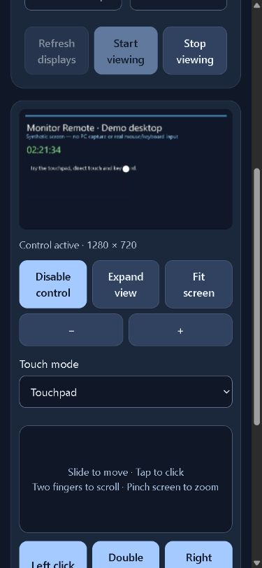
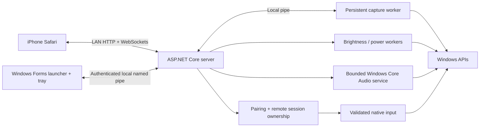

# Monitor Remote

**A Windows desktop companion that turns iPhone Safari into a local PC controller.**

View a selected Windows display, control the mouse with touch, type from your phone, and adjust playback or microphone endpoint volume. External-monitor brightness and all-display off/wake controls are also available. A Windows Forms launcher manages the server, QR pairing, permissions and tray controls; the phone uses plain HTML, CSS and JavaScript without a native app or cloud service.

**Platform:** Windows · **Backend:** C# / .NET 10 / ASP.NET Core · **Desktop:** Windows Forms · **Phone interface:** HTML, CSS, JavaScript and WebSockets

This project targets a reachable, trusted home LAN. By default HTTP/WebSocket traffic is unencrypted; turn on HTTPS (see Encryption and remote access) before using it away from home. Windows unlocking from the phone and waking a sleeping PC are not included.

## What it does

| Area | Implemented behavior |
| --- | --- |
| Screen viewing | Live JPEG frames from one selected display, viewing quality choices, zoom and fit |
| Mouse and keyboard | Touchpad or direct-touch input, drag/scroll/click controls, on-screen keys and committed Unicode text |
| Audio | Default playback volume/mute and individual output/input endpoint controls; bulk actions target playback devices |
| Displays | DDC/CI brightness where supported and off/wake requests for all displays |
| Local control | Six-digit QR-assisted pairing, separate viewing/input/audio permissions, session revocation and Stop remote session |

<details>
<summary>Phone interface preview — synthetic demo</summary>



Existing browser demo capture from the 3 October 2026 validation. The displayed desktop and input are synthetic; this image does not establish real screen capture or iPhone Safari acceptance.

</details>

## Architecture and engineering choices



- **Process ownership:** a Windows job ties the launcher to its server and child processes. Brightness/power requests use short-lived workers; screen capture uses a separate persistent worker with bounded waits.
- **Explicit permission and session boundaries:** viewing, input and audio permissions start disabled on server launch. Input requires viewing permission and phone-side control selection. Pairing revocation and heartbeat expiry end the remote session and release held input.
- **Stale-state protection:** mouse/keyboard commands include frame sequence and display revision checks. Audio writes target endpoint IDs and a catalog revision; default-device guards prevent redirecting a queued PC-volume change.
- **Honest operation results:** requested settings and readback are separate. Failed or uncertain commands are not automatically replayed after reconnection, and bulk audio operations report per-device results.

The source includes origin/request validation, pairing rate limits, bounded input and same-site session cookies. These controls complement the trusted-LAN scope; the network guidance below explains the current transport limits.

## Get started from source

Use Windows with the .NET 10 SDK. Node.js with built-in `fetch` support is needed for the JavaScript checks. From the repository root:

```powershell
dotnet build MonitorRemote.csproj
dotnet build desktop/MonitorRemote.Desktop.csproj
```

Run `dotnet run` for the console server, or build a portable Windows package with the packaging command below. The server prints a phone URL and pairing code. Viewing, input and audio permissions require explicit opt-in; see Network and packaging for the console flags.

Generated `artifacts` and the older local `App` folder are ignored and are not included in a source clone. This repository has no published GitHub release at the time of this documentation update. Recreate a package locally rather than treating workspace artifact paths as downloads.

## Run the Windows app

After packaging, open the new folder under `artifacts` and double-click `MonitorRemote.Desktop.exe`. If this README is inside a package, use the executable beside it. Keep the whole folder together, including its DLLs and `server` folder. The self-contained Windows x64 package requires no SDK or terminal. An existing local `App` folder, if present, contains the earlier brightness/power release.

The server starts automatically. Scan the PC app's QR with iPhone Camera and enter the six-digit pairing code in Safari within ten minutes. Keep the PC awake and the app running; Ethernet on the PC and Wi-Fi on the phone work on the same reachable network.

Enable the features you want in the PC app:

- **Allow screen viewing:** the phone's Desktop tab can list and view a selected display.
- **Allow mouse and keyboard control:** permits touch and typing after screen viewing is enabled. The phone separately selects Enable control.
- **Allow audio volume control:** enables Audio, independently of screen sharing.

These permissions start disabled after each server start/restart. The PC app shows sharing/control status. Stop remote session in the window or tray ends sharing and releases its held inputs. Removing a permission takes effect during existing connections.

Start, Stop and Restart manage the server. New pairing code preserves connected phones and local permissions; Disconnect all phones revokes their sessions. Closing the window hides it to the tray; Exit stops the app and its server/worker. Windows sign-in startup is opt-in. Disable it before moving/removing the folder; if the folder is gone, disable Monitor Remote under Windows Settings > Apps > Startup.

## Desktop and typing

Choose Desktop, refresh displays if needed, select a screen and quality, then Start viewing. Laptop displays can be viewed even when brightness is unsupported. Select Enable control to use touch and keyboard input. Stop viewing before switching displays or turning them off.

Touchpad mode: slide to move, tap to click, long press for right click, and use two fingers or the scroll strip to scroll. Hold Drag while moving on the touchpad. Left click, Double click and Right click buttons are available. Direct touch mode maps the viewed screen to the PC pointer; enable Drag, then touch and move. Pinch the screen to zoom, or use zoom/Fit screen controls.

Open Keyboard for letters, special keys and shortcuts. Click the intended PC text field first. The phone text field opens the native phone keyboard; Send text sends committed text once, including multiline/Unicode text, up to 1024 UTF-16 characters. Ctrl, Shift and Alt apply to the next applicable on-screen key. Check the target application for the result.

Input is disabled when the displayed frame is stale. Leaving Desktop, backgrounding/locking the phone, stopping, losing the connection or revoking pairing ends sharing. Start viewing/control again explicitly. Clicks and text are never replayed. If an acknowledgement is lost, input may already have reached Windows; inspect the target field before typing it again.

Windows must be unlocked on its normal desktop. Lock screens, UAC secure desktops and disconnected Windows sessions end sharing. Higher-privilege apps may reject input from this normally launched app. Protected video and some accelerated/HDR content may not capture correctly. This release targets ordinary desktop interaction; it does not stream PC sound, unlock Windows or wake a sleeping PC.

## PC and device volume

Audio shows **PC volume** for the default playback endpoint, plus individual cards for every Windows playback/input endpoint. Volume and mute are independent: adjusting volume preserves mute. Disabled, unplugged or unsupported devices are listed with unavailable controls.

**Apply to all**, **Mute all** and **Unmute all** target the currently listed active playback endpoints. Different output levels show Mixed; each operation reports individual success/failure. Microphones retain their settings. Change microphone/input level and mute on their own cards where Windows supports them. This controls endpoint master volume, including application sound sent to that endpoint; it does not provide a per-application mixer or channel-by-channel controls.

Windows/hardware volume changes refresh while Audio is visible. Refresh after device/default changes or an uncertain operation. Writes are tied to endpoint IDs and the current catalog; a default change cannot silently redirect a PC-volume write. Queued changes are discarded on failure/disconnection and never replayed on reconnect.

### Applications and PC sound streaming

The Audio tab also lists **Applications**: each program with a Windows audio session gets its own volume and mute per playback device. It uses the same **Allow audio volume control** permission. Some protected programs may refuse a change; the card then reports it.

**Listen to PC sound** streams everything the PC plays (including notifications) to the phone as Opus audio over a WebSocket. It needs **Allow PC sound streaming** in the PC app, which is off at every launch, plays on one phone at a time, and ends when the permission is turned off, the phone is revoked or Stop remote session is chosen. The PC speakers keep playing. Nothing is recorded or stored. Playback uses WebCodecs, so iOS 26 or a current desktop browser is required. Expect roughly 100 to 200 ms of delay; it is not suited to lip-sync-critical video.

## Existing display controls

Enable DDC/CI in the monitor menu for brightness. Laptop internal screens and some docks/adapters may not support it. Brightness cards distinguish requested settings from readback; failures restore the last confirmed reading and offer explicit retry. Rapid edits settle on the latest selection. Monitor IDs follow the current physical enumeration; refresh after cabling changes.

Off/wake affects all displays, not PC power. Turning displays off is disabled while remote viewing is active. Wake resets the Windows display idle timer; keyboard/mouse recovery may still be needed. It does not unlock Windows or dismiss a screen saver. Requests time out after 12 seconds and may already have reached the PC; reconnect and inspect before retrying. Power state remains unconfirmed.

## Network and packaging

If Windows asks for firewall access, allow Private networks only. An administrator can add a narrowly scoped rule if needed; the app does not change the firewall:

```powershell
New-NetFirewallRule -DisplayName 'Monitor Remote Home LAN' -Direction Inbound -Action Allow -Protocol TCP -LocalPort 8765 -Profile Private -RemoteAddress LocalSubnet
```

Use trusted home Wi-Fi. HTTP/WebSocket traffic, including screen images, typed text and pairing, is unencrypted. Do not forward the port on your router. Access from mobile data or another location requires a separate encrypted/private-network extension and is not included. Guest Wi-Fi isolation, VPNs and sleeping PCs can prevent connection. A router DHCP reservation keeps the PC URL stable. Set `MONITOR_PORT` before launch to change the port and adjust the rule accordingly.

Build a fresh portable package with:

```powershell
powershell -ExecutionPolicy Bypass -File .\package.ps1
```

Output is a new folder under `artifacts`; existing packages are preserved. Executables are unsigned. `-Runtime win-arm64` supports ARM64 packaging but has not been validated. `-FrameworkDependent` requires matching .NET 10 ASP.NET Core and Windows Desktop runtimes.

For development, install the .NET 10 SDK and run `dotnet run`. Feature permissions are disabled by default; to opt in for a console session:

```powershell
dotnet run -- --allow-viewing --allow-input --allow-audio
```

`desktop`, `Remote`, `Audio`, `wwwroot`, root C# files and `tests` are source. `docs` holds the implementation plan, guide and validation history. Build folders can be regenerated.

## Encryption and remote access

HTTPS is optional and configured through environment variables (or `desktop.json` for the launcher): `MONITOR_TLS_CERT` (PFX path), `MONITOR_TLS_PASSWORD`, `MONITOR_TLS_PORT` (default 8766), `MONITOR_ALLOWED_HOSTS` (comma-separated hostnames the server may be reached by) and `MONITOR_ALLOW_HTTP=0` to turn the plain port off. A renewed certificate file is picked up without a restart.

The supported way to reach the PC away from home is **Tailscale**: install it on the PC and phone, run `tailscale cert <pc-name>.<tailnet>.ts.net`, convert the result to a PFX, list that hostname in `MONITOR_ALLOWED_HOSTS`, and open `https://<pc-name>.<tailnet>.ts.net:8766` on the phone. Do not forward a router port; the pairing code is not meant to protect an internet-facing service.

Phones outside the home network (any address that is not loopback or private IPv4, including Tailscale `100.x` addresses) can enter the pairing code but must then be **approved on the PC**; the launcher shows a prompt. Remote sessions last 2 hours (LAN sessions 12), allow 5 pairing attempts per 10 minutes, and every pairing, approval, revocation and permission change is appended to `%LocalAppData%\MonitorRemoteudit.log` (no secrets or typed text). `MONITOR_AUDIT_FILE` overrides the path.

When the PC is locked, the Desktop tab says so. Wake the display from the Displays tab and unlock at the PC; entering a password from the phone is not supported (see `docs/UNLOCK_SPIKE.md`).

## Checks and real-device acceptance

```powershell
dotnet build tests/MonitorRemote.Checks.csproj
node tests/smoke.mjs
node tests/frontend.mjs
node tests/features.mjs
dotnet tests/bin/Debug/net10.0/MonitorRemote.Checks.dll
```

Automated remote/audio checks use synthetic frames, input and devices. They do not capture the real desktop, inject real mouse/keyboard input or change real audio. `--read-audio` on the checks executable separately enumerates actual Windows audio devices read only. The packaged launcher `--check` uses demo mode; set `MONITOR_CHECK_REPORT` to a report path before running it.

The [validation record](docs/VALIDATION.md) reports 42 synthetic remote/audio checks and 21 packaged launcher checks passing on 3 October 2026, alongside the JavaScript checks and demo browser QA. These are dated project results, not a fresh hardware acceptance claim from this documentation update.

Test actual iPhone Safari gestures, portrait/landscape, native keyboard resizing, Wi-Fi loss, lock/UAC, display/DPI changes, real typing and speaker/microphone readback on your setup. ARM64, real Safari/native-hardware acceptance and measured latency remain unverified.

## Source map and further reading

| Path | Responsibility |
| --- | --- |
| [Program.cs](Program.cs), [PairingState.cs](PairingState.cs) | Hosting, API protection, pairing and session tokens |
| [LocalManagement.cs](LocalManagement.cs), [ManagementProtocol.cs](ManagementProtocol.cs) | Launcher-to-server management |
| [Hardware.cs](Hardware.cs) | Native brightness/power and demo workers |
| [Remote](Remote) | Display discovery, capture, input and session lifecycle |
| [Audio](Audio) | Core Audio interop, device catalog, readback and routes |
| [desktop](desktop) | Windows launcher, tray, QR, preferences and process ownership |
| [wwwroot](wwwroot) | Phone interface and request/connection state |
| [tests](tests) | Synthetic API, frontend, remote/audio and launcher checks |
| [package.ps1](package.ps1) | Portable Windows packaging |

Read the [developer guide](docs/DEVELOPER_GUIDE.md) for implementation details and the [remote desktop design](docs/REMOTE_DESKTOP_IMPLEMENTATION.md) for capture, input and audio behavior. The Markdown developer guide is current; the checked-in PDF predates the remote/audio extension. [Project state](docs/PROJECT_STATE.md) records delivery context and remaining acceptance work. Developer links and the demo image refer to the source repository; the portable package retains these operating instructions without the `docs` folder.

## Licensing

Third-party dependency licenses are recorded in [THIRD_PARTY_NOTICES.md](THIRD_PARTY_NOTICES.md). The repository currently has no project-level license file; those dependency notices do not grant a license to this project's own code.
